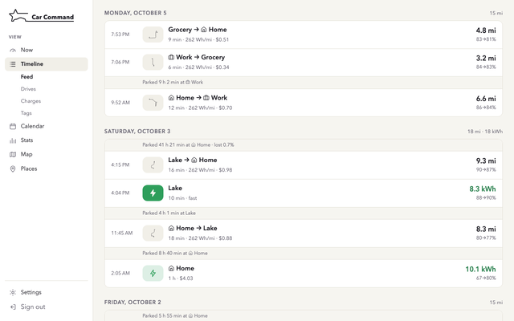
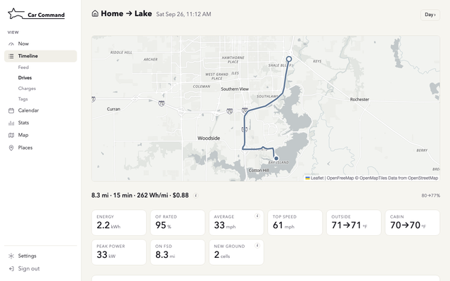
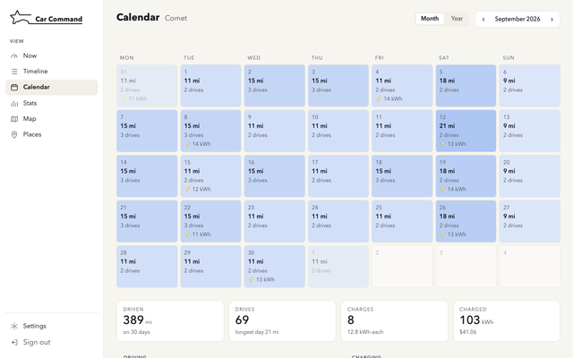
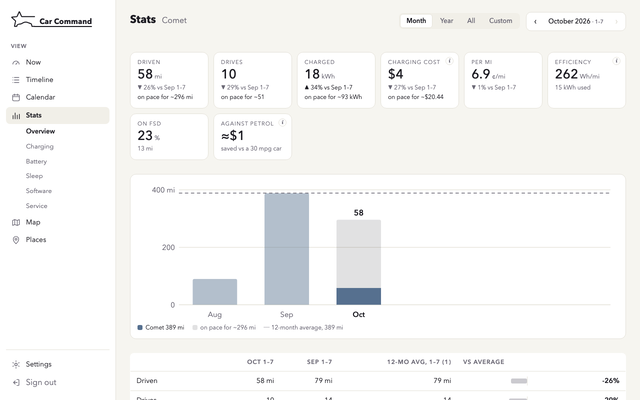
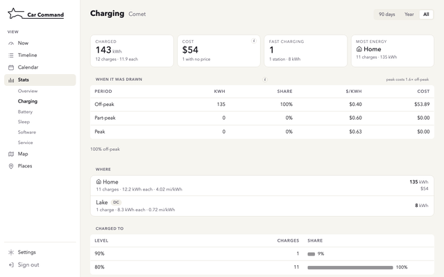
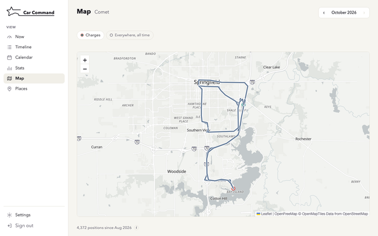

<!-- Links and badges name the repository as epheterson/car-command here; scripts/publish-snapshot.sh writes in the real path. -->

<div align="center">

<picture>
  <source media="(prefers-color-scheme: dark)" srcset="brand/mark-arrive-night.svg">
  
</picture>

<h1>Car Command</h1>

<p>Every drive, every charge, every car. On your own server.</p>

<picture>
  <source media="(prefers-color-scheme: dark)" srcset="brand/media/demo-dark.gif">
  
</picture>

<p>
<a href="https://github.com/epheterson/car-command/actions/workflows/test.yml"></a>
<a href="https://github.com/epheterson/car-command/releases/latest"></a>
<a href="https://scorecard.dev/viewer/?uri=github.com/epheterson/car-command"></a>
<a href="LICENSE"></a>
</p>

</div>

## Quick start

Docker on an amd64 or arm64 machine:

```sh
docker run -d --name carcommand --restart unless-stopped --stop-timeout 30 -p 3044:3044 -v carcommand:/data ghcr.io/epheterson/car-command
```

Get the setup code with `docker exec carcommand carcommand web python3 setup_code.py`, open `http://<host>:3044`, choose a password with that code, and add your cars under **Settings › Cars and sources**. The first password needs the code unless the request comes from the machine itself or, in the first hour, a device on your home network (on Docker Desktop that is never, so use the code). Postgres, the site and the connector run in this one container, and everything it keeps is in the `carcommand` volume.

To look around first, `docker exec carcommand carcommand demo` loads six weeks of a fictional car. `docker stop carcommand && docker rm carcommand && docker volume rm carcommand` removes it.

Settings, backups and upgrades: [docs/install.md](docs/install.md).

## What it does

Car Command logs drives and charges for one or more electric cars, of different makes, on one site. Cars connect through [CarConnectivity](https://github.com/tillsteinbach/CarConnectivity) (Lucid, the Volkswagen group brands, Tronity) or straight from Tesla, and history can be imported from TeslaFi or TeslaMate.

Each charge is priced from your time-of-use plan by the hour the car drew power, a price you set for the place, or what Tesla billed for a Supercharger session. Otherwise it takes the regional average, marked `≈`.

With a Tesla Powerwall at home, each home charge is split into sun, Powerwall and grid, and the sun counts as free. Phone apps can [connect](docs/api.md) with a sign-in inside the app, for widgets and live activities that see each car's state but not where it is.

## Docker Compose

Compose runs the same parts as separate containers, from a checkout. The [local maps add-on](docs/maps.md) and the [Tesla live stream](docs/tesla-stream.md) need it for now.

```sh
git clone https://github.com/epheterson/car-command car-command && cd car-command
make setup                                                # writes stack/.env with generated passwords
docker compose -f stack/docker-compose.yml up -d db web   # Postgres, the schema, and the site
```

For Lucid or another CarConnectivity brand, start the connector too: `docker compose -f stack/docker-compose.yml up -d`. `make demo` loads the demo car, and `make one-container-move` [moves a compose install](docs/install.md#moving-a-compose-install-into-the-one-container) into the one container.

## Features

<table>
<tr>
<td width="33%" valign="top"><a href="docs/screenshots/timeline.png"></a><br><b>Timeline</b><br>Drives and the stops between.</td>
<td width="33%" valign="top"><a href="docs/screenshots/drive.png"></a><br><b>Drive</b><br>Route, speed, energy and cost.</td>
<td width="33%" valign="top"><a href="docs/screenshots/calendar.png"></a><br><b>Calendar</b><br>A month or a year at a glance.</td>
</tr>
<tr>
<td valign="top"><a href="docs/screenshots/stats.png"></a><br><b>Stats</b><br>Cars side by side, month by month.</td>
<td valign="top"><a href="docs/screenshots/charging.png"></a><br><b>Charging</b><br>Every charge, priced.</td>
<td valign="top"><a href="docs/screenshots/map.png"></a><br><b>Map</b><br>Every drive, each car in its colour.</td>
</tr>
</table>

Also: efficiency by temperature and speed, the same miles priced in gas, a service log with reminders and tire sets, trip tags, alerts (Discord, Telegram, email, Pushover), CSV and JSON export, an [API](docs/api.md), dark mode and a phone layout. Raw readings are kept, so drives and charges can be recomputed after a fix.

## Sources

| Source | Live data | Drive route and power | Charge curve | History before you connect |
|---|---|---|---|---|
| Tesla, direct | about once a second with the [stream](docs/tesla-stream.md) | both | yes | import from TeslaFi or TeslaMate |
| TeslaFi (feed and export) | each minute | both | yes | the export |
| TeslaMate (database) | as TeslaMate records | both | yes | its database |
| Lucid ([connector](https://github.com/epheterson/CarConnectivity-connector-lucid)) | each minute, 15 s driving | route only | yes | none |
| Audi, Cupra, SEAT, Škoda, Volkswagen, Tronity ([CarConnectivity](https://github.com/tillsteinbach/CarConnectivity#connectors)) | per connector | route | per connector | none |

Add sources under **Settings › Cars and sources**. The CarConnectivity brands other than Lucid are untested here; if you run one, [open an issue](https://github.com/epheterson/car-command/issues/new/choose). Details: [docs/sources.md](docs/sources.md).

## Privacy

Your cars' data stays in your own database. What leaves your machine:

- **Your sources** (Tesla, TeslaFi, a CarConnectivity connector) receive your sign-in, to send your car's data.
- **Map backgrounds** (off by default): OpenFreeMap receives the map tiles you view.
- **Place names** (off by default): OpenStreetMap's Nominatim receives each new stop's position, rounded to about 100 m. The [local maps add-on](docs/maps.md) names places on your machine instead; it downloads its regions from Geofabrik.
- **Weather** (off by default): Open-Meteo receives each drive's start, rounded to about 1 km, and its date.
- **Find my plan**: OpenEI receives the ZIP code or utility name you type.
- **Alerts**: the service you choose (Discord, Pushover, Telegram, email) receives the alert.

## Documentation

[Install](docs/install.md) · [Sources](docs/sources.md) · [Tesla live stream](docs/tesla-stream.md) · [Costs](docs/costs.md) · [Local maps](docs/maps.md) · [API](docs/api.md) · [Changelog](CHANGELOG.md) · [Contributing](CONTRIBUTING.md) · [Security](SECURITY.md)

<!-- Star history: hidden until there are stars to chart.
     To show it, delete this comment's first and last lines.
## Star history

<a href="https://star-history.com/#epheterson/car-command&Date">
  <picture>
    <source media="(prefers-color-scheme: dark)" srcset="https://api.star-history.com/svg?repos=epheterson/car-command&type=Date&theme=dark">
    
  </picture>
</a>
-->

## Credits

- **Car data:** [CarConnectivity](https://github.com/tillsteinbach/CarConnectivity) and its connectors.
- **Maps:** © [OpenStreetMap contributors](https://www.openstreetmap.org/copyright) (ODbL), extracts from [Geofabrik](https://download.geofabrik.de), backgrounds from [OpenFreeMap](https://openfreemap.org) (© [OpenMapTiles](https://www.openmaptiles.org/)). The local maps add-on runs [Valhalla](https://github.com/valhalla/valhalla) (MIT) and [osmium](https://osmcode.org/osmium-tool/) (GPL-3.0, as a separate tool).
- **Prices:** US EIA, Eurostat and the EU Weekly Oil Bulletin; US utility plans from [OpenEI](https://openei.org/wiki/Utility_Rate_Database).
- **Weather:** [Open-Meteo](https://open-meteo.com).
- **Icons:** [Lucide](https://lucide.dev) (ISC).

## License

[PolyForm Noncommercial 1.0.0](LICENSE): free to use, change and share for any noncommercial purpose. Selling it, a modified version, or a hosted service built on it requires permission.

---

Built with ❤️ in California by [@epheterson](https://github.com/epheterson) and [Claude Code](https://claude.com/claude-code).
