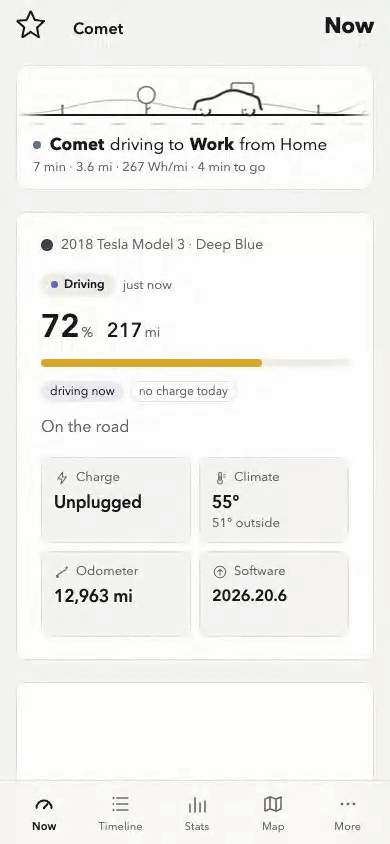
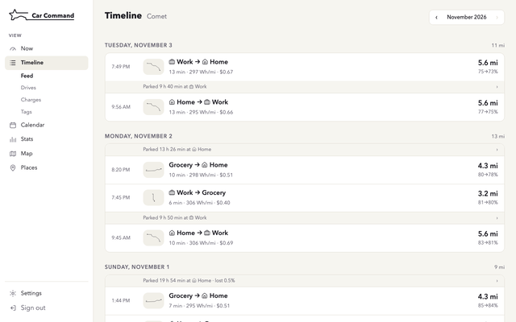
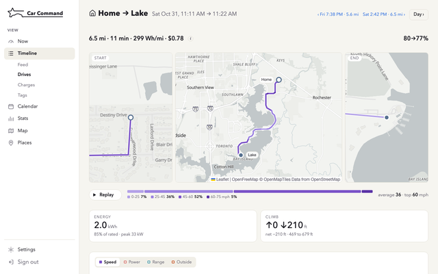
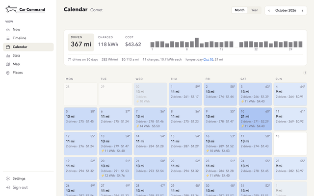
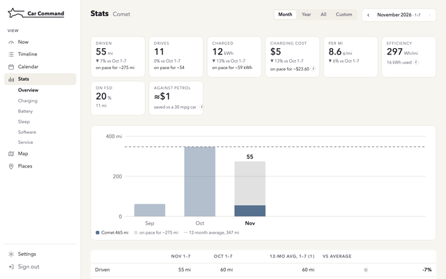
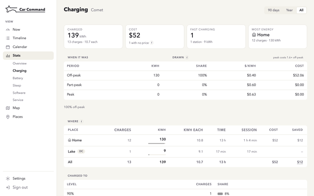
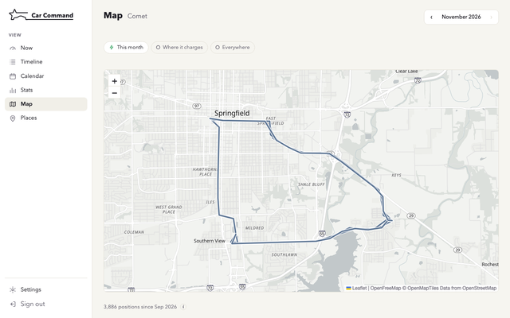

<!-- Links and badges name the repository as epheterson/car-command here; scripts/publish-snapshot.sh writes in the real path. -->

<div align="center">

<picture>
  <source media="(prefers-color-scheme: dark)" srcset="brand/mark-arrive-night.svg">
  
</picture>

<h1>Car Command</h1>

<p>Every drive, every charge, every car. On your own server.</p>

<picture>
  <source media="(prefers-color-scheme: dark)" srcset="brand/media/demo-dark.gif">
  
</picture>

<p>
<a href="https://github.com/epheterson/car-command/actions/workflows/test.yml"></a>
<a href="https://github.com/epheterson/car-command/releases/latest"></a>
<a href="LICENSE"></a>
</p>

</div>

## What it is

A logbook and dashboard for your household's electric cars, on a machine you own.

- **Every car on one site:** Tesla (live, about once a second), Lucid, and the other [CarConnectivity](https://github.com/tillsteinbach/CarConnectivity) brands.
- **Your history comes with you:** import years of drives and charges from TeslaFi, TeslaMate or Tessie.
- **Real costs:** every charge priced at your own rates, by the hour, Supercharger bills included.
- **Solar and Powerwall:** home charges split into sun, Powerwall and grid.
- **Battery, service, logbook:** battery health, efficiency, service reminders, a mileage logbook, alerts, export.
- **Commands, if you want them:** charging, climate, locks and more, with Face ID for anything that opens the car. [More](docs/commands.md)
- **Garage door, hands free:** opens as you turn in, closes as you leave (Home Assistant and a driveway camera).
- **Home Assistant:** each car published over MQTT, discovered automatically.

<br>

<table>
<tr>
<td width="33%" valign="top"><a href="docs/screenshots/timeline.png"></a><br><b>Timeline</b><br>Drives and the stops between.</td>
<td width="33%" valign="top"><a href="docs/screenshots/drive.png"></a><br><b>Drive</b><br>Route, speed, energy and cost.</td>
<td width="33%" valign="top"><a href="docs/screenshots/calendar.png"></a><br><b>Calendar</b><br>A month or a year at a glance.</td>
</tr>
<tr>
<td valign="top"><a href="docs/screenshots/stats.png"></a><br><b>Stats</b><br>Cars side by side, month by month.</td>
<td valign="top"><a href="docs/screenshots/charging.png"></a><br><b>Charging</b><br>Every charge, priced.</td>
<td valign="top"><a href="docs/screenshots/map.png"></a><br><b>Map</b><br>Every drive, each car in its colour.</td>
</tr>
</table>

## Quick start

```sh
docker run -d --name carcommand --restart unless-stopped --stop-timeout 30 -p 3044:3044 -v carcommand:/data ghcr.io/epheterson/car-command
```

1. Get the setup code: `docker exec carcommand carcommand web python3 setup_code.py` (not needed from your home network in the first hour).
2. Open `http://<host>:3044`, choose a password, and add your cars under **Settings › Cars and sources**.

Everything lives in the `carcommand` volume. [Docker Compose, the demo, backups and upgrades](docs/install.md) · [Troubleshooting](docs/troubleshooting.md)

## Sources

| Source | Live data | History before you connect |
|---|---|---|
| Tesla, direct | about once a second, with the [stream](docs/tesla-stream.md) | import from TeslaFi or TeslaMate |
| TeslaFi | each minute | its export |
| TeslaMate | as it records | its database |
| Tessie | none | its API |
| Lucid ([connector](https://github.com/epheterson/CarConnectivity-connector-lucid)) | each minute, 15 s driving | none |
| Audi, Cupra, SEAT, Škoda, VW, Tronity ([CarConnectivity](https://github.com/tillsteinbach/CarConnectivity#connectors)) | per connector (untested here) | none |

[Details](docs/sources.md)

## Privacy

Your cars' data stays in your own database. What leaves your machine:

| Sent to | What | When |
|---|---|---|
| Your car sources | your sign-in | always |
| OpenFreeMap | the map tiles you view | map backgrounds on |
| OpenStreetMap Nominatim | a new stop's position, to about 100 m | place names on (or name places locally with [local maps](docs/maps.md)) |
| Open-Meteo | a drive's start, to about 1 km, and its date | weather on |
| OpenEI | the utility you pick | finding your rate plan |
| Your MQTT broker, alert service | car state, alerts | when you set them up |

## Documentation

[Install](docs/install.md) · [Sources](docs/sources.md) · [Tesla app](docs/tesla-app.md) · [Tesla live stream](docs/tesla-stream.md) · [Commands](docs/commands.md) · [Costs](docs/costs.md) · [Local maps](docs/maps.md) · [API](docs/api.md) · [Troubleshooting](docs/troubleshooting.md) · [Roadmap](docs/roadmap.md) · [Changelog](CHANGELOG.md) · [Contributing](CONTRIBUTING.md) · [Security](SECURITY.md)

<!-- Star history: hidden until there are stars to chart.
     To show it, delete this comment's first and last lines.
## Star history

<a href="https://star-history.com/#epheterson/car-command&Date">
  <picture>
    <source media="(prefers-color-scheme: dark)" srcset="https://api.star-history.com/svg?repos=epheterson/car-command&type=Date&theme=dark">
    
  </picture>
</a>
-->

## Credits

- **Car data:** [CarConnectivity](https://github.com/tillsteinbach/CarConnectivity) and its connectors.
- **Maps:** © [OpenStreetMap contributors](https://www.openstreetmap.org/copyright) (ODbL), extracts from [Geofabrik](https://download.geofabrik.de), backgrounds from [OpenFreeMap](https://openfreemap.org) (© [OpenMapTiles](https://www.openmaptiles.org/)). The local maps add-on runs [Valhalla](https://github.com/valhalla/valhalla) (MIT) and [osmium](https://osmcode.org/osmium-tool/) (GPL-3.0, as a separate tool).
- **Prices:** US EIA, Eurostat and the EU Weekly Oil Bulletin; US utility plans from [OpenEI](https://openei.org/wiki/Utility_Rate_Database); utilities by ZIP code from NREL's [U.S. Electric Utility Companies and Rates: Look-up by Zipcode](https://data.openei.org/submissions/6225) ([CC BY 4.0](https://creativecommons.org/licenses/by/4.0/), filtered and re-encoded).
- **Terrain:** [Terrain Tiles](https://registry.opendata.aws/terrain-tiles/) (Mapzen/Tilezen) on AWS Open Data, a blend of SRTM, USGS 3DEP, EU-DEM and other national models; each source and its attribution is listed in [joerd's attribution.md](https://github.com/tilezen/joerd/blob/master/docs/attribution.md).
- **Weather:** [Open-Meteo](https://open-meteo.com).
- **Icons:** [Lucide](https://lucide.dev) (ISC) and [MingCute](https://github.com/Richard9394/MingCute) (Apache-2.0).

## License

[PolyForm Noncommercial 1.0.0](LICENSE): free for any noncommercial use. Selling it or hosting it as a service needs permission.

---

Built with ❤️ in California by [@epheterson](https://github.com/epheterson) and [Claude Code](https://claude.com/claude-code).
